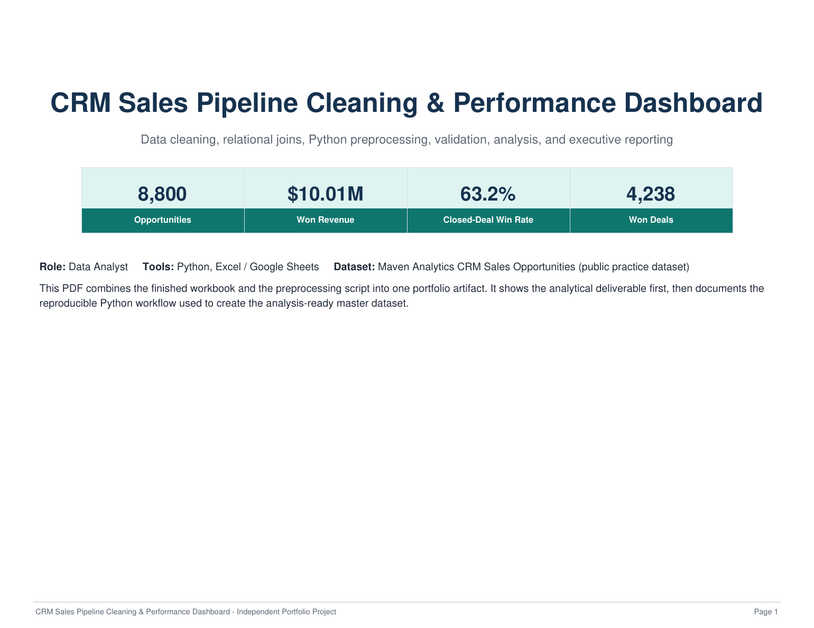

# CRM Sales Pipeline & Revenue Performance Analysis

**Python + Excel portfolio project**

This project analyzes a public CRM sales-opportunities dataset using a reproducible Python preprocessing workflow and an Excel management dashboard. The analysis focuses on revenue performance, win rates, products, sales teams, individual reps, sectors, accounts, and monthly trends.



## Key results

- **8,800** sales opportunities analyzed
- **$10.01M** in won revenue
- **4,238** won deals
- **63.2%** closed-deal win rate
- GTX Pro + GTX Plus Pro generated **61.4% of won revenue** from **27.8% of opportunities**
- Top sales rep generated approximately **$1.15M** in won revenue

## Business questions

1. How much revenue did the pipeline generate?
2. Which products contribute the most revenue?
3. Which teams and sales reps perform best?
4. Which sectors and customer accounts drive results?
5. How does performance change over time?
6. Are pricing and sales-cycle differences associated with performance?

## Technical workflow

The Python preprocessing script:

- loads four relational source files;
- standardizes known source inconsistencies without altering raw files;
- enriches opportunities using account, product, and sales-team lookup tables;
- creates sales-cycle, close-period, stage-flag, and price-variance fields;
- validates row counts and unique opportunity IDs;
- reconciles processed won revenue back to the source total;
- exports an analysis-ready `master_opportunities.csv`.

## Data-quality decisions

Two known source inconsistencies are standardized in the derived analysis layer:

- `GTXPro` → `GTX Pro`
- `technolgy` → `technology`

Blank account values are preserved rather than guessed. Missing close dates and close values are retained for open opportunities.

## Repository structure

```text
crm-sales-pipeline-analysis/
├── README.md
├── .gitignore
├── python/
│   └── CRM_Sales_Preprocessing.py
├── deliverables/
│   ├── CRM_Sales_Opportunities_Portfolio_Final.xlsx
│   └── CRM_Sales_Portfolio_Combined.pdf
├── images/
│   └── dashboard_preview.png
└── docs/
    └── project_notes.md
```

## Tools

- **Python** — preprocessing, joins, calculated fields, validation
- **Excel / Google Sheets** — KPI reporting, PivotTables, dashboarding
- **CSV / relational data** — accounts, products, sales pipeline, sales teams

## Reproducibility

The preprocessing script expects these source files in its working directory:

```text
accounts.csv
products.csv
sales_pipeline.csv
sales_teams.csv
```

Run:

```bash
python CRM_Sales_Preprocessing.py
```

The script creates:

```text
master_opportunities.csv
```

The public source dataset is available from Maven Analytics rather than being duplicated in this repository.

## Portfolio deliverables

- Editable Excel analysis workbook
- Combined PDF portfolio report
- Reproducible Python preprocessing script
- Validation and methodology notes

## Dataset

**Maven Analytics — CRM Sales Opportunities**  
Public practice dataset: https://mavenanalytics.io/data-playground/crm-sales-opportunities
